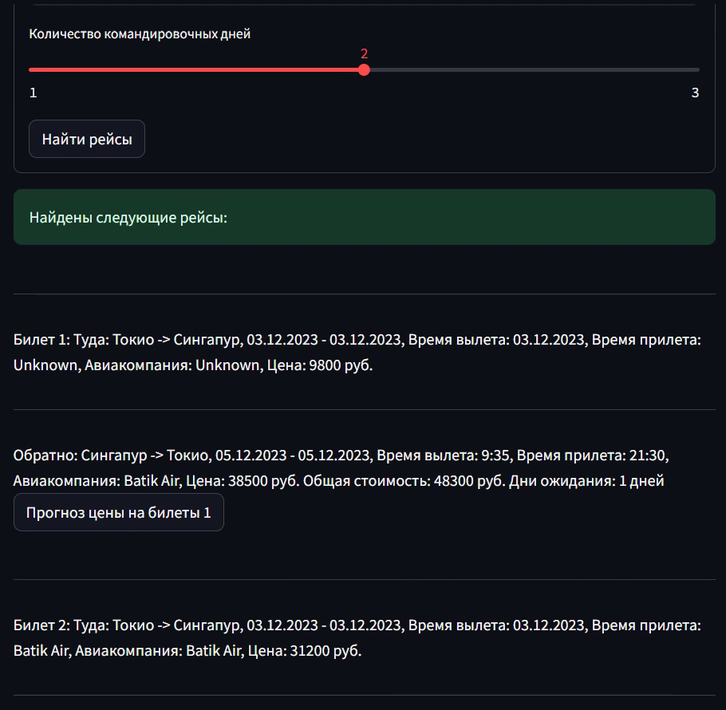

# Hack_aviasales

**A business-trip flight finder with price charts: a Flask API and a Streamlit interface over a SQLite database of flights.**

English | [Русский](README.ru.md)



A hackathon-style project (December 2023). You choose a departure city, a destination, a date and the length of the trip
(1 to 3 days); the service finds every outbound and return flight that fits, combines them into round trips and ranks them
by total price and by the days spent waiting. For each trip it can draw the price history of both legs and extend it with
a simple forecast. Everything runs locally: a Flask backend serves JSON, a Streamlit page renders it, and the flights live
in a single SQLite file.

## Features

* **Round-trip search**: `/api/flights` takes the route, the departure date and the number of business-trip days, looks
  up outbound and return flights and returns all combinations sorted by total price, then by waiting days.
* **Graceful misses**: when nothing matches exactly, the response carries an `alternative_results` flag and the page shows
  the closest tickets that may still suit you instead of an empty screen.
* **Price charts with a forecast**: `/api/price_forecast` returns every known price of a route; the page plots the
  actual prices and continues them 180 days ahead (linear interpolation scaled by an inflation factor) with Plotly.
* **Cities from the data**: the city lists in the form are read from the database, so they follow whatever data you load.
* **Data pipeline**: `amadeus_api.py` pulls flights from the Amadeus API (test environment) into `cities.csv` and
  `flights.csv`, converting prices to roubles with a currency table; `sqlite_import_from_api.py` loads the CSV files into
  `AirTickets.db`. The bundled database also contains rows from a ready-made Kaggle dataset (27 cities, 9 740 flights).
* **Demo videos** of the working service (`*.mp4`) and the original run notes in Russian.

### API

| endpoint | parameters | returns |
|---|---|---|
| `GET /api/flights` | `departure_city`, `destination_city`, `departure_date` (`YYYY-MM-DD`), `business_trip_days` | `{"flights": [...], "alternative_results": 0\|1\|2}` |
| `GET /api/price_forecast` | `departure_city`, `destination_city` | list of `[departure date, price]` for the route |

## Requirements

* Python ≥ 3.9;
* Flask, Streamlit, requests, pandas, scipy, plotly, mplcursors (`pip install flask streamlit requests pandas scipy plotly mplcursors`);
* only to refresh the data: an Amadeus for Developers account (the test API is free).

## Installation

```bash
git clone https://github.com/<your-account>/Hack_aviasales.git
cd Hack_aviasales
pip install flask streamlit requests pandas scipy plotly mplcursors
```

## Quick start

```bash
python main.py                      # backend on http://localhost:5000
streamlit run streamlit_front.py    # interface on http://localhost:8501 (second terminal)
```

Pick a route that exists in the database (for example Tokyo → Singapore in the demo), set the date and the number of
trip days and press **Найти рейсы** ("Find flights"). Each result has a button that draws the price history of its two
legs and the forecast.

### Refreshing the data

```bash
python amadeus_api.py               # writes cities.csv and flights.csv (needs your Amadeus test credentials)
python sqlite_import_from_api.py    # loads them into AirTickets.db
```

> Put your own Amadeus client id and secret into `amadeus_api.py` (register at developers.amadeus.com). Amadeus returns
> prices in the currency of the departure country; the script converts them with a fixed table of rates.

## Repository layout

```
main.py                    Flask backend: /api/flights, /api/price_forecast
streamlit_front.py         Streamlit interface, Plotly charts, forecast
amadeus_api.py             data from the Amadeus API → cities.csv, flights.csv
sqlite_import_from_api.py  CSV → AirTickets.db
AirTickets.db              SQLite: tables Flights and Cities
docs/                      screenshots
*.mp4, *.txt               demo videos, run instructions and code notes (Russian)
```

## Limitations

* The forecast is a linear interpolation of the known prices with a correction factor and is cut at zero, not a trained
  model: treat it as an illustration of the interface.
* The Flask server runs in debug mode and the frontend expects it on `localhost:5000`: this is a local demo, not a
  deployment.
