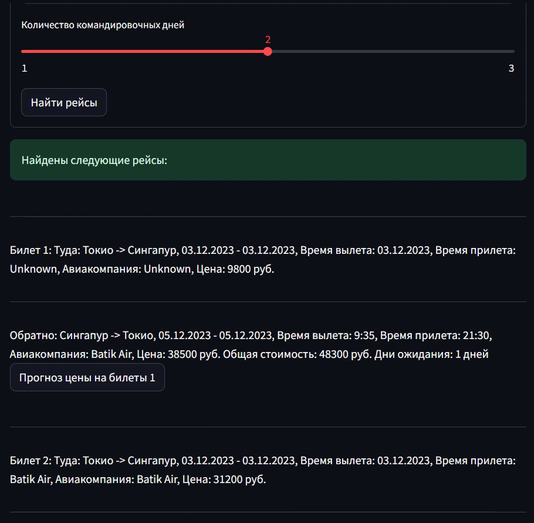

# Hack_aviasales

**Поиск авиабилетов для командировок с графиками цен: бэкенд на Flask и интерфейс на Streamlit поверх базы SQLite.**

[English](README.md) | Русский



Проект в формате хакатона (декабрь 2023). Вы выбираете город вылета, город назначения, дату и длительность командировки
(от 1 до 3 дней); сервис находит все подходящие рейсы туда и обратно, собирает из них варианты поездки и ранжирует по
суммарной цене и по дням ожидания. Для каждого варианта можно построить историю цен обоих рейсов и продлить её простым
прогнозом. Всё работает локально: бэкенд на Flask отдаёт JSON, страница на Streamlit его показывает, а рейсы лежат в
одном файле SQLite.

## Возможности

* **Поиск «туда и обратно»**: `/api/flights` принимает маршрут, дату вылета и число командировочных дней, ищет рейсы туда
  и обратно и возвращает все сочетания, отсортированные по общей цене, затем по дням ожидания.
* **Аккуратные промахи**: если точного совпадения нет, в ответе приходит флаг `alternative_results`, и страница
  показывает ближайшие билеты, которые могут подойти, а не пустой экран.
* **Графики цен с прогнозом**: `/api/price_forecast` возвращает все известные цены маршрута; страница рисует фактические
  цены и продолжает их на 180 дней вперёд (линейная интерполяция с поправкой на инфляцию) средствами Plotly.
* **Города из данных**: списки городов в форме читаются из базы, поэтому они следуют загруженным данным.
* **Конвейер данных**: `amadeus_api.py` берёт рейсы из Amadeus API (тестовая среда) в `cities.csv` и `flights.csv`,
  пересчитывая цены в рубли по таблице курсов; `sqlite_import_from_api.py` загружает CSV в `AirTickets.db`. В
  поставляемой базе есть и строки из готового датасета с Kaggle (27 городов, 9 740 рейсов).
* **Демо-видео** работающего сервиса (`*.mp4`) и исходные заметки по запуску на русском.

### API

| endpoint | параметры | возвращает |
|---|---|---|
| `GET /api/flights` | `departure_city`, `destination_city`, `departure_date` (`YYYY-MM-DD`), `business_trip_days` | `{"flights": [...], "alternative_results": 0\|1\|2}` |
| `GET /api/price_forecast` | `departure_city`, `destination_city` | список `[дата вылета, цена]` по маршруту |

## Требования

* Python ≥ 3.9;
* Flask, Streamlit, requests, pandas, scipy, plotly, mplcursors (`pip install flask streamlit requests pandas scipy plotly mplcursors`);
* только для обновления данных: аккаунт Amadeus for Developers (тестовый API бесплатный).

## Установка

```bash
git clone https://github.com/<your-account>/Hack_aviasales.git
cd Hack_aviasales
pip install flask streamlit requests pandas scipy plotly mplcursors
```

## Быстрый старт

```bash
python main.py                      # бэкенд на http://localhost:5000
streamlit run streamlit_front.py    # интерфейс на http://localhost:8501 (во втором терминале)
```

Выберите маршрут, который есть в базе (например, Токио → Сингапур, как в демо), задайте дату и число дней поездки и
нажмите **Найти рейсы**. У каждого результата есть кнопка, которая рисует историю цен двух его рейсов и прогноз.

### Обновление данных

```bash
python amadeus_api.py               # пишет cities.csv и flights.csv (нужны ваши тестовые ключи Amadeus)
python sqlite_import_from_api.py    # загружает их в AirTickets.db
```

> Впишите свои client id и secret от Amadeus в `amadeus_api.py` (регистрация на developers.amadeus.com). Amadeus отдаёт
> цены в валюте страны вылета; скрипт пересчитывает их по фиксированной таблице курсов.

## Структура репозитория

```
main.py                    бэкенд на Flask: /api/flights, /api/price_forecast
streamlit_front.py         интерфейс Streamlit, графики Plotly, прогноз
amadeus_api.py             данные из Amadeus API → cities.csv, flights.csv
sqlite_import_from_api.py  CSV → AirTickets.db
AirTickets.db              SQLite: таблицы Flights и Cities
docs/                      скриншоты
*.mp4, *.txt               демо-видео, инструкция по запуску и заметки к коду (на русском)
```

## Ограничения

* Прогноз — это линейная интерполяция известных цен с поправочным коэффициентом, обрезанная на нуле, а не обученная
  модель: считайте его иллюстрацией интерфейса.
* Сервер Flask работает в режиме отладки, а фронтенд ждёт его на `localhost:5000`: это локальная демонстрация, а не
  развёртывание.
